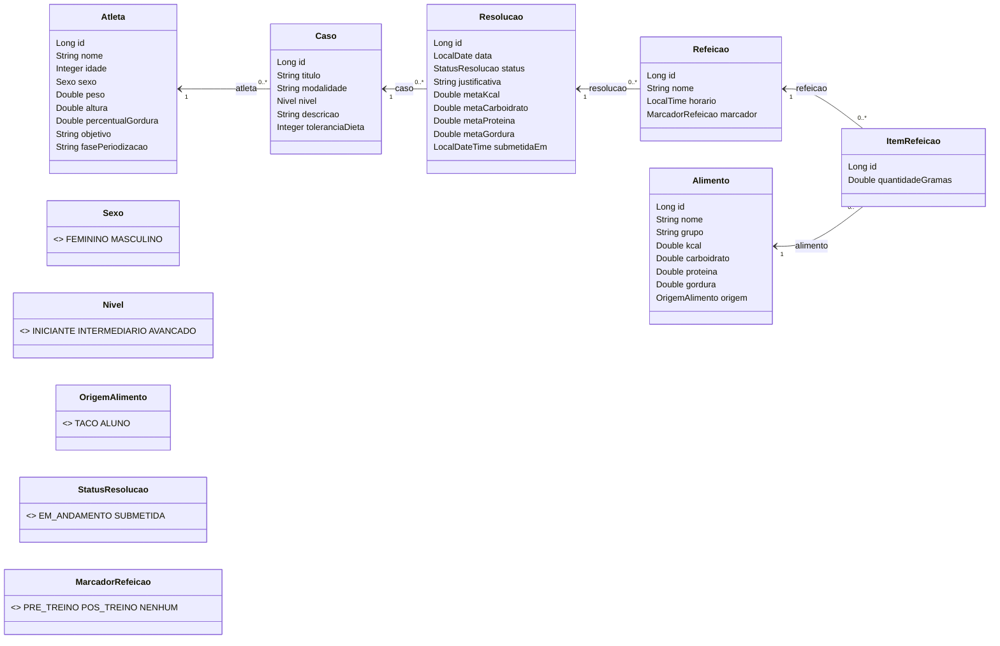

# Diagrama de classes — NutriCase API

No banco (MySQL), cada seta vira uma chave estrangeira: `caso.atleta_id`, `resolucao.caso_id`, `refeicao.resolucao_id`, `item_refeicao.refeicao_id` e `item_refeicao.alimento_id`.
